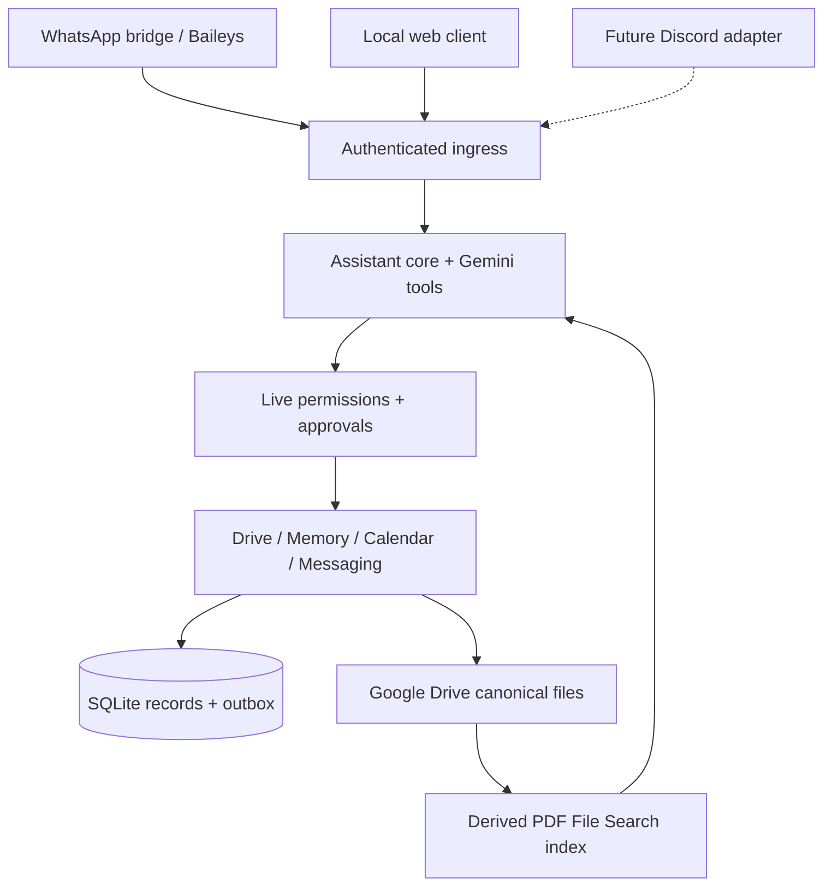

# Architecture and future channels

`app/assistant.py` handles conversational context, request limits and provider calls. `app/providers/` defines the replaceable model boundary. `app/project_tools.py` exposes read tools and structured actions. `app/actions.py` enforces capability rules, action receipts and approval workflows. `app/commands.py` retains optional diagnostic shortcuts behind the same policy.

Google credentials stay in backend services. Drive scope is the configured project root; file/index mappings preserve source identity. Calendar routines separate event reads/writes from manual busy intervals. Persistent work-package state and decisions are separate from background context files.

The implemented WhatsApp adapter is the Node service under `whatsapp/` plus `app/whatsapp.py`. It resolves phone/LID identity, recognizes group triggers, receives media and handles durable delivery. The web client uses the same Python core with a local owner session. SQL and transport details are intentionally simple for one small team.

`app/channels/contracts.py` describes the future adapter boundary. It is an extension contract, not a working Discord integration. A Discord implementation must verify its gateway identity, map Discord users to approved backend users, namespace conversation/event IDs, translate attachments into the existing ingestion service, and route the outbox to its own sender. Existing authorization/group records are currently WhatsApp-oriented; extend those mappings explicitly rather than pretending a Discord ID is a phone number.

Keep the assistant core, tools, permission enforcement and document services shared. Put channel-specific authentication, mentions, reply context, media limits and delivery uncertainty in the adapter. Do not create a second decision store or a second copy of project files for a new channel.

The current runtime is single-process/single-worker. Scaling, multi-tenant isolation, external browser login, 24/7 deployment and distributed scheduling need separate design work. No autonomous multi-agent framework is required for this MVP.
